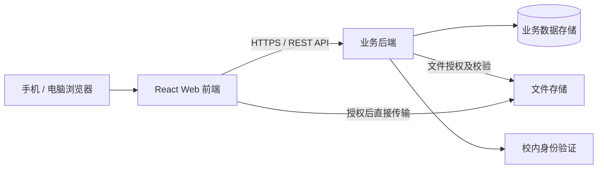

# 逸学 V1.0｜项目技术与接口开发方案（统一版）

> 2026-11-27 · 团队评审稿（资料分享链接确认版）  
> 面向全体项目成员、前后端开发人员及 Codex。本文整合项目总体说明、前端开发说明与接口规范，作为唯一阅读和评审入口。后端语言、框架、数据库和内部架构不作强制限制。

**阅读顺序：** A1–A3 项目范围与技术架构；A4 前端设计与开发（前端重点）；A5–A6 性能及协作；B 部分接口规范（前后端共同评审）。

## A. 技术方案

### A1｜项目范围与建设目标

逸学面向中山大学五个信息类学院，提供期末真题、课件、笔记等学习资料的检索、预览、下载、投稿与征集。初版只建设资料共享平台，AI 问答、长期记忆和学习规划留待后续版本。

| 项目 | V1.0 要求 |
|---|---|
| 服务范围 | 计算机学院、软件工程学院、人工智能学院、网络空间安全学院、智能工程学院 |
| 文件规模 | 现有约 300 份，预计增长至约 1,000 份 |
| 在线规模 | 峰值 100 人同时在线 |
| 终端 | 手机与电脑，用户端核心操作完整适配；管理端以电脑为主，手机支持基本管理 |
| 身份 | 全站登录访问，无游客模式；普通用户、管理员 |
| 认证 | 参考软工集市现有企微邮箱验证实现 |

初版页面及业务模块：

| 用户端 | 管理端 |
|---|---|
| 登录、首页、学习资料库 | 管理工作台 |
| 多维筛选、搜索、资料详情、预览及下载 | 资料审核、编辑、上下架、批量上传与分类 |
| 资料征集、响应征集 | 学院、课程、资料类型管理 |
| 用户投稿、个人中心、本人投稿编辑及撤回 | 征集公告发布、编辑、关闭 |

一份资料支持多个附件，可单独下载；支持按学院逐级浏览、组合筛选及跨学院搜索。来源、版本及每份资料独有的逸学站内分享链接均支持展示；分享链接指向资料详情页，登录后可访问。用户投稿完成必要的文件安全检查后直接向已登录用户公开，人工审核不阻塞发布；拒绝后下架。本人编辑后重新进入待审核，不得自行恢复管理员下架的资料。

年级指适用年级（大一至大四），学期为上/下学期，资料年份独立记录。课程可关联多个学院，资料可适用于多个学院与年级。征集由管理员发布、完成或关闭，响应投稿不自动完成征集。初版不做收藏、下载历史、社区、积分、全文检索/OCR、Office 在线预览及独立 App；后续按实际反馈迭代。

### A2｜总体架构

采用前后端分离架构，用户端与管理端共用一个前端工程，独立布局及权限路由。



后端建议采用模块化单体架构。文件与业务元数据分开存储，优先考虑私有对象存储（COS / OSS 等）及短期签名链接，避免大文件上传下载挤占业务服务器带宽。具体实现可由后端同学根据现有资源调整。初版不要求 Redis、Elasticsearch、微服务或独立向量数据库；CDN 按实际访问体验选择。

### A3｜技术选型

| 层级 | 方案 | 说明 |
|---|---|---|
| 前端基础 | React + TypeScript + Vite | 静态构建、前后端独立开发 |
| UI 与响应式 | Tailwind CSS + shadcn/ui | 统一样式和跨屏布局 |
| 路由 | React Router | 登录、用户端、管理端路由分离 |
| 数据请求 | TanStack Query | 缓存、请求状态及分页 |
| 表单与表格 | React Hook Form + Zod、TanStack Table | 投稿、后台管理 |
| 图标 | Lucide | 仅用于有明确语义的操作 |
| 文档预览 | PDF.js | PDF 按需加载，图片直接预览 |
| 联调 | OpenAPI + Orval + MSW | 统一接口类型、模拟接口 |
| 测试 | Vitest + Playwright | 核心逻辑、多视口及端到端测试 |
| 后端 | 自主选型；FastAPI、NestJS、Spring Boot 等均可 | 不限定语言及内部实现 |
| 数据库 | 自主选型；关系型数据库如 PostgreSQL 可供参考 | 保存资料、课程、用户及公告等元数据 |
| 文件存储 | 推荐对象存储 | 私有访问、授权下载、支持扩容 |
| 部署 | 自主选型；单机 Docker Compose + Nginx 可供参考 | 先满足当前规模及安全要求 |

前端使用稳定版本并锁定依赖。后端提供接口、认证、权限、文件校验、数据持久化及部署能力即可，无需遵循前端建议的数据库表或项目目录结构。

### A4｜前端设计与开发

设计目标：方便快捷、直观美观、低 AI 感。以资料查找和下载为核心，不把平台做成宣传官网；手机端独立组织导航、筛选和阅读，不机械堆叠桌面组件。用户端与管理端同一工程，独立布局和权限路由。TypeScript 启用 strict，使用 ESLint、Prettier 和锁定依赖的 lockfile。

#### A4.1 参考项目与使用方式

| 参考 | 链接 | 借鉴内容 |
|---|---|---|
| GitHub Primer | https://primer.style/ · https://github.com/primer/react | 文件列表、紧凑排版、分隔线、状态与操作按钮 |
| NUSMods | https://nusmods.com/ · https://github.com/nusmodifications/nusmods | 高校课程目录、课程搜索与导航 |
| Zotero Web Library | https://github.com/zotero/web-library | 文档元数据、阅读与资料组织 |
| OpenAlex | https://openalex.org/ · https://github.com/ourresearch/openalex-gui | 组合筛选、已选条件、结果组织 |
| Shadcn Admin | https://github.com/satnaing/shadcn-admin | 管理端侧栏、表格、批量操作、表单 |
| WHUT Resource | https://github.com/zygame1314/whut-resource | 资料共享、征集及运营流程 |
| Unishare | https://github.com/unishare-oss/unishare | 高校资料平台的业务与工程组织 |

参考信息架构与交互模式，不照搬品牌或整站 UI。复用源码前核对许可证及依赖；这些参考项目尚未在本项目中运行测试，不把其实现视为已验证的生产底座。

#### A4.2 工程结构建议

```text
src/
  app/                 # 路由、全局 Provider、错误边界
  layouts/             # 登录、用户端、管理端布局
  pages/               # 页面级入口
  features/            # auth、resources、requests、uploads、admin
  components/          # 通用 UI 与业务组件
  api/                 # 统一请求客户端、生成的接口代码
  mocks/               # MSW handlers、示例数据
  styles/              # 设计 token、全局样式
  utils/               # 格式化、文件与 URL 工具
  tests/               # 单元与集成测试
```

接口生成目录不手动修改。服务端数据放 TanStack Query；筛选、排序与分页放 URL；局部表单和弹窗用组件状态。不引入不必要的全局状态框架。认证状态统一管理；生产环境不保留 mock 登录或模拟业务数据。

#### A4.3 视觉规范（初始设计方向）

采用现代校园知识库风格，主色为低饱和校园绿，搭配中性白灰。颜色为建议值，正式品牌资产确定后可统一替换。

| Token | 建议值 / 使用方式 |
|---|---|
| 品牌主色 | `#245C46`，主要按钮、链接选中态、品牌标识 |
| 页面背景 | `#F7F8F7`，仅在需要区分工作区时使用 |
| 内容背景 | `#FFFFFF` |
| 正文 | `#202523` |
| 次级正文 | `#616B65` |
| 边框 | `#E2E6E3` |
| 选中背景 | `#E9F0EB` |
| 字体 | 中文系统无衬线/思源黑体回退；英文 Inter 或系统字体 |
| 圆角 | 4–8 px 为主；弹窗可适当放大 |
| 间距 | 4、8、12、16、24、32 px 的统一尺度 |
| 字号 | 正文 14–16 px，页面标题 24–28 px，辅助信息 12–14 px |

正文、链接和状态文本需满足可读性与对比度要求。状态不得只用颜色区分。表单、菜单、抽屉支持键盘、焦点管理和可访问名称。图标按钮有明确含义与触控区域。

**避免：** 巨幅 Hero、蓝紫渐变、卡片套卡片、过多胶囊标签、玻璃拟态、无意义插画、复杂动画、占满首屏的统计数据。首页可以有适度品牌表达，但核心仍是搜索。

#### A4.4 信息架构与路由

| 路由 | 页面 | 权限 |
|---|---|---|
| `/login` | 校内登录 | 未登录可访问 |
| `/` | 首页 | 已登录 |
| `/resources` | 资料库 | 已登录 |
| `/resources/:id` | 资料详情 | 已登录 |
| `/resources/:id/preview/:fileId` | 独立阅读页 | 已登录且有资料访问权 |
| `/requests` | 资料征集列表 | 已登录 |
| `/requests/:id` | 征集详情 | 已登录 |
| `/upload` | 投稿 | 已登录 |
| `/profile` | 个人中心 | 已登录 |
| `/profile/submissions` | 我的投稿 | 已登录 |
| `/profile/submissions/:id/edit` | 编辑自己的投稿 | 本人 |
| `/admin` | 管理工作台 | 管理员 |
| `/admin/resources` | 资料管理与审核 | 管理员 |
| `/admin/resources/import` | 批量录入 | 管理员 |
| `/admin/categories` | 分类与课程管理 | 管理员 |
| `/admin/requests` | 征集公告管理 | 管理员 |

用户端桌面导航：逸学标识、首页、资料库、资料征集、我要投稿，右侧个人菜单；管理员显示管理入口。移动端建议底部四项导航（首页、资料、征集、我的），投稿在资料/征集页面或个人中心提供显眼入口。避免双重导航占用空间。

未登录访问业务路由，先检查会话并跳转登录，保留站内目标地址；认证加载时显示中性加载态，不闪现受保护页面。返回地址仅允许合法站内路径，防止开放重定向。部署时须支持前端路由深链接及刷新（如 SPA history fallback），API 路由不受影响。

#### A4.5 页面设计与交互

##### A4.5.1 登录页

居中登录表单，简洁展示逸学名称、校内认证说明。认证交互对齐软工集市现有机制，不预设必须输入密码。提供验证中、失败、重试及会话失效提示。登录后默认首页，或返回原站内目标。手机端表单全宽且不被软键盘遮挡。

##### A4.5.2 首页

桌面：顶部导航 → 紧凑搜索区（自然标题，如“查找学习资料”）→ 五学院快捷入口 → 近期更新与资料征集两个区域。课程快捷入口可按真实数据增加，不虚构热门课程统计。

手机：搜索优先；学院入口可采用两列或紧凑换行；近期更新和征集依次展示，限制首页条数并提供“查看更多”。

搜索提交后进入资料库，携带关键词；点击学院进入已筛选资料列表。首页各区不重复堆放同类资料。

##### A4.5.3 资料库（核心页面）

桌面：顶部搜索框；左侧约 220–260 px 的筛选区；右侧结果区。结果区包含总数、排序、已选条件、紧凑列表与分页。大屏下使用合理的内容最大宽度，不将文字拉得过长。

```text
逸学   首页  资料库  资料征集  我要投稿                个人菜单
----------------------------------------------------------------
学习资料库
[ 搜索课程名称、资料标题……                                  ]
----------------------------------------------------------------
学院        |  18 份资料                  最新上传 ▼
课程        |  已选：软件工程学院 ×  期末真题 ×  清除
年级        |  -------------------------------------------------
学期        |  PDF  数据结构 2025 年期末真题       预览  下载
资料类型    |       软件工程学院 · 期末真题 · 已审核
资料年份    |       2025 · 2 个附件
            |  -------------------------------------------------
            |  分页
```

- 筛选维度：学院、课程、年级、学期、资料类型、资料年份。支持逐级选择和独立搜索；同一维度多选 OR，维度间 AND。学院筛选变化后不兼容的课程选项清除并提示，不自动选择其他课程。
- 课程选择器可输入关键词搜索；支持跨学院浏览。课程、学院等从接口加载。
- 筛选即时生效，搜索输入防抖约 300 ms；提交搜索即时执行。改变筛选或排序时回到第 1 页。
- URL 保存关键词、筛选、排序和页码；浏览器前进/后退正常工作。详情返回后保留筛选及列表位置。
- 默认按最新上传排序，支持年份及下载热度（以接口统计口径为准）。每页默认 20 条。
- 列表以资料为单位，不把附件拆成多条重复记录。单附件可直接下载；多附件点击下载弹出附件选择。预览仅对支持的文件启用。
- 加载时保留布局，可使用简短骨架；空结果显示清除筛选入口；失败显示重试，不把错误当成空列表。

移动端：顶部搜索，下方筛选和排序入口；筛选在底部抽屉或全屏弹层中完成，点击“查看结果”提交；已选条件可折叠。结果使用紧凑单列文件列表，标题可两行换行，下载触控区域足够大。禁止将桌面侧栏完整堆在列表上方。

##### A4.5.4 资料详情与阅读

标题、课程、学院、类型、年级、学期、年份、来源、版本、审核状态及简介清晰展示。附件列表显示原始文件名、格式和大小，分别提供预览与下载。

**逸学链接（站内分享）：** 每份资料具有唯一、稳定的详情页地址，例如 `https://yixue.example.com/resources/res_001`（示例域名）。前端根据配置的正式站点域名及经过 URL 编码的资料 ID 自动生成，在详情页展示并提供“复制链接”，资料列表可通过更多操作复制。使用 Clipboard API，内置浏览器不支持时提供可选中、手动复制的地址。已登录用户打开链接直接进入对应资料；未登录用户完成校内认证后自动回到该资料详情页。编辑标题、分类、版本或附件不改变资料 ID 与原链接；已下架、撤回或不存在的资料显示不可访问提示。分享链接不是下载链接，不包含登录凭证、签名 URL 或文件路径，不绕过全站登录。

桌面阅读页：顶部返回、文件名、页码、缩放及下载；中央阅读器，右侧可折叠资料信息。移动端：全屏阅读、简洁工具栏、缩放和返回，处理横竖屏及安全区域。PDF 逐页/按需渲染，不一次渲染整个文档；图片按需加载。Word、PPT、Excel、ZIP 初版下载即可。签名链接过期时重新申请一次，失败提供重试。

未通过安全检查的文件不进入可下载列表；管理员下架后，普通用户不能通过原详情地址重新获取文件权限。

##### A4.5.5 资料征集

独立列表页按征集中、已完成、已关闭筛选，默认征集中。展示标题、关联课程、学院、资料类型、发布日期及状态；详情展示需求说明与响应按钮。已关闭/完成不再允许响应。响应跳转 `/upload?request_id=...`，根据接口返回值预填分类，保留用户可编辑的普通字段，明确关联征集。

##### A4.5.6 我要投稿

页面以简洁表单和文件队列为主。桌面支持拖拽和文件选择，手机支持系统文件选择器。

字段：资料标题、学院（可多选）、课程、年级（可多选）、学期、资料年份、资料类型、来源、版本、资料说明、附件。逸学链接在资料创建后自动生成，不需要投稿者填写。必填以接口规范为准。

支持一份资料多个附件，各附件独立显示进度、成功/失败、重试、移除。提交前验证字段和上传状态，防重复提交，检查分享权限确认。安全检查进行中显示“正在检查”，完成后展示“已发布，待审核”，失败给出原因，不假报发布成功。保留本次页面中已填写的表单和成功上传的附件，方便重试。

管理端批量录入可为多份独立资料统一设置公共分类，再逐份补充；普通投稿初版不要求完整的多条资料批量编辑器。

##### A4.5.7 个人中心

显示昵称、校内认证信息、退出登录和我的投稿入口。投稿列表展示标题、时间、审核/展示状态，支持查看、编辑、撤回。审核拒绝/管理员下架时展示后端返回的原因。撤回二次确认；编辑后明确重新审核。不能操作他人投稿。收藏、下载历史与消息中心不作为 P0。

##### A4.5.8 管理端

- 工作台：简洁展示资料数、待审核数、进行中征集数及快捷入口；不强制绘制统计图表。
- 资料管理：表格支持搜索、学院/课程/审核状态/展示状态筛选、编辑、通过/拒绝、上下架；拒绝须填写原因。支持多选与基本批量操作，并展示每条失败原因。资料详情可复用用户端展示组件。
- 批量录入：文件队列、公共标签、逐条标题/年份/类型修改、进度与结果反馈。无需初版实现复杂 Excel 导入页面。
- 分类管理：学院、课程、资料类型的新增、编辑、停用；年级与学期读取统一配置即可，不强制额外管理页。停用分类不得破坏既有资料的历史展示。
- 征集管理：新建、编辑、发布、查看关联投稿、完成、关闭。
- 手机后台：支持待审核查看、审核、上下架、公告基本管理；表格切为紧凑列表或详情操作，复杂批量编辑主要在电脑使用。

#### A4.6 响应式规范

| 视口宽度 | 布局策略 |
|---|---|
| 320–639 px | 手机，单栏、底部导航、筛选抽屉、全宽表单 |
| 640–767 px | 大屏手机，适当增加内容间距 |
| 768–1023 px | 平板，按可用空间采用单栏或双栏 |
| 1024 px 及以上 | 桌面，完整顶部导航、筛选侧栏、表格 |

使用 CSS Grid/Flex、`min-width: 0`、流式宽度及合理的容器限制，避免固定宽度和依赖绝对定位的主布局。触控目标建议至少 44 × 44 px。长文件名允许换行或省略并提供完整名称；表单字段不能撑破容器。禁止异常横向溢出、组件重叠、按钮遮挡或关键功能隐藏。文档本身的缩放/平移不属于普通页面溢出。

兼容 Chrome、Edge、Safari，以及微信/企业微信内置浏览器的核心流程。移动端处理安全区域、虚拟键盘、横竖屏与文件选择。真机下载行为可能因系统/内置浏览器而异，无法直接下载时提供清晰的浏览器打开指引，不绕过鉴权。

#### A4.7 性能与工程要求

- 路由及 PDF 阅读器懒加载；避免把后台组件、全量课程资料或大文件放入首屏包。
- TanStack Query 缓存分类、处理请求去重与失效；登录退出时清理用户相关缓存。搜索使用防抖及过期请求取消，分页避免一次加载全部记录。
- 文件上传采用后端约定的传输方式，推荐直传对象存储；文件内容不进入全局状态、日志或本地持久化。上传并发限制为 3 个起步（可调整）。签名 URL 不持久缓存。
- 请求统一处理 401、403、404、409、413、429 和服务端错误；上传错误和表单错误单独展示。认证凭证不得写入日志；不在前端保存云存储密钥。
- 页面不直接拼接不可信 HTML；外部链接仅允许安全协议并提示外跳。禁止将测试账号、密钥、内部地址写进提交代码。

#### A4.8 开发顺序与验收

1. 工程初始化、设计 token、路由与登录保护、用户端/管理端布局。
2. Mock 接口、首页和资料库，优先完成桌面及手机布局。
3. 资料详情、预览下载、投稿、征集与个人中心。
4. 管理后台及批量录入。
5. 真实认证与 API 联调、移动端真机测试、性能与异常处理验收。

| 验收项 | 通过标准 |
|---|---|
| 全站登录 | 未登录无法获取受保护数据，登录后可回原目标页 |
| 搜索筛选 | 组合筛选正确、URL 可分享、返回保留状态 |
| 资料查看 | 多附件分别下载、支持格式可预览、来源与版本正确显示 |
| 资料分享 | 复制详情链接；已登录直接访问，未登录认证后回跳；刷新深链接正常；修改资料后链接不变，下架后不可访问 |
| 投稿 | 多附件上传、进度、失败重试、审核状态、编辑和撤回正常 |
| 管理端 | 审核与上下架、批量录入、分类和公告管理可用 |
| 响应式 | 320、375、390、768、1024、1440、1920 px 无异常错位/溢出 |
| 真机 | Android 与 iOS 各至少一台；验证登录、筛选、上传、预览、下载 |
| 测试 | Playwright 覆盖关键流程及不同视口；生产构建通过 |
| 性能 | 结合后端压测验证 100 人在线场景，不因文件下载阻塞业务页面 |

设计评审优先检查首页、资料库和手机筛选流程，再扩展统一视觉到其他页面。所有示例资料只用于 Mock，正式环境使用真实接口。本节是开发依据，而不是已经完成的 UI 设计稿。

### A5｜性能、安全及交付

| 项目 | 建议验收目标 |
|---|---|
| 容量 | 300 份增长至 1,000 份无需修改架构；统计实际大小后配置存储配额 |
| 并发 | 100 人同时在线的典型搜索、详情和下载场景；有余力可额外测试 300 人 |
| 接口 | 典型检索请求 P95 ≤ 300 ms（不含文件传输），压测记录错误率与请求组合 |
| 页面 | 良好网络下首页主要内容建议 2 秒内可用，移动端另测 |
| 文件 | 文件传输不阻塞业务操作，权限验证、进度与失败反馈正常 |
| 安全 | 服务端鉴权、管理权限、文件安全检查、私有存储或等效保护、数据备份和恢复验证 |

以上为建设与验收目标，而非实测结果。在线人数不等于 QPS，服务器配置及实际成本由后端同学结合现有资源和压测决定。

### A6｜协作方式

前端负责人负责用户端、管理端、响应式体验、接口接入及前端测试；后端负责人负责业务服务、认证与权限、数据和文件管理及部署。双方先评审下文接口，冻结后前端使用 Mock 并行开发，后端按契约实现。优先联调登录、分类、资料检索，再联调文件、投稿、征集及后台。

待确认事项见 B12，不阻塞前端基础工程和页面开发。

## B. 前后端接口方案

接口基于已讨论的 V1.0 业务规则，提供具体路径、字段类型及响应示例。除认证协议等标注暂定项外，作为双方评审基线；不限制服务端内部实现。认证发起/完成及上传实现细节以双方最终冻结契约为准。

### B1｜通用约定

- 基础路径 `/api/v1`；HTTPS；JSON 请求与响应（实际文件传输除外）。优先同域部署，开发环境可使用代理。
- 资源 ID 一律为不透明字符串；不假设自增整数或 UUID 格式。时间为 ISO 8601，建议 UTC；前端按本地时区显示。
- 字段命名 `snake_case`；字节数为整数；年份为四位整数；可选且无值的业务字段返回 `null`，数组为空返回 `[]`。
- 所有业务接口必须登录，管理接口必须有管理员身份。登录发起/验证、回调及会话检查是必要例外。每次文件授权须校验资料状态及用户权限。
- POST 创建返回 201，普通成功返回 200；HTTP 状态码表达失败类型，不以 HTTP 200 包装错误。分页默认 20 条，最大 100 条。
- 查询多值采用重复参数，例如 `college_ids=c1&college_ids=c2`；不同筛选维度 AND，同一维度 OR。
- PATCH 未传字段保持原值，显式 `null` 清空可空字段；传入数组代表完整替换。业务校验失败不部分修改单条记录。

成功响应：

```json
{"code":"OK","message":"success","data":{"id":"res_001"}}
```

分页响应（通用 `Page<T>`）：

```json
{"code":"OK","message":"success","data":{"items":[],"total":0,"page":1,"page_size":20}}
```

失败响应：

```json
{
  "code":"VALIDATION_ERROR",
  "message":"请填写资料标题",
  "data":null,
  "errors":[{"field":"title","message":"标题不能为空"}]
}
```

`errors` 为可选字段。以下接口表中的返回类型均指 `data` 内部结构；无业务返回值为 `null`。所有示例为模拟数据，不是真实校内资料或用户。

### B2｜公共数据类型

以下用 TypeScript 表达契约，不限制服务端语言。标注 `?` 的字段可省略；其余响应字段必须返回。

```ts
type ID = string;
type Timestamp = string;
type Role = 'user' | 'admin';
type ReviewStatus = 'pending' | 'approved' | 'rejected';
type Visibility = 'published' | 'hidden' | 'withdrawn';
type SafetyStatus = 'checking' | 'passed' | 'failed';
type RequestStatus = 'open' | 'completed' | 'closed';
type Grade = 1 | 2 | 3 | 4;
type Semester = 'first' | 'second';
type Sort = 'latest' | 'year_desc' | 'popular';
type Page<T> = { items: T[]; total: number; page: number; page_size: number };

type User = {
  id: ID; display_name: string; email: string; role: Role;
};
type Category = { id: ID; name: string; active: boolean };
type Course = Category & { college_ids: ID[]; aliases: string[] };
type Choice<T> = { value: T; label: string };
type Catalog = {
  colleges: Category[]; resource_types: Category[];
  grades: Choice<Grade>[]; semesters: Choice<Semester>[];
};
type Attachment = {
  id: ID; filename: string; content_type: string;
  size_bytes: number; preview_supported: boolean;
};
type ResourceSummary = {
  id: ID; title: string; course: Category; colleges: Category[];
  grades: Grade[]; semester: Semester | null; year: number | null;
  resource_type: Category; source: string | null; version: string | null;
  review_status: ReviewStatus; safety_status: SafetyStatus;
  visibility: Visibility; file_count: number;
  files: Attachment[]; download_count: number;
  created_at: Timestamp; updated_at: Timestamp;
};
type ResourceDetail = ResourceSummary & {
  description: string | null;
  request_id: ID | null;
};
type OwnResource = ResourceDetail & {
  review_reason: string | null; visibility_reason: string | null;
  safety_reason: string | null; can_edit: boolean; can_withdraw: boolean;
};
type AdminResource = OwnResource & {
  uploader: { id: ID; display_name: string };
};
type RequestItem = {
  id: ID; title: string; description: string; status: RequestStatus;
  colleges: Category[]; course: Category | null;
  resource_type: Category | null; grades: Grade[];
  semester: Semester | null; year: number | null;
  submission_count: number; created_at: Timestamp; updated_at: Timestamp;
};
```

`files` 在列表中只含附件元数据，不返回存储路径或下载签名；`file_count` 与当前可见的 `files.length` 一致。安全检查中或失败的附件不得成为普通资料列表中的可下载内容。普通资料列表只包含 `safety_status=passed` 且 `visibility=published` 的资料，人工待审核状态仍可显示。本人和管理员查询可包含其他状态。

`download_count` 初版定义为成功签发下载授权的次数（不是实际完成传输次数），前端显示“下载请求次数”或明确该口径。

### B3｜认证与会话

**认证业务行为已确定，具体认证协议未确定。** 参考软工集市既有企微邮箱验证，不自行实现不兼容的登录方式。以下会话接口及前端行为可以先确定；发起/完成认证的接口在查看已有实现后冻结。

| 方法 | 路径 | 权限 | 请求 | 返回 |
|---|---|---|---|---|
| GET | `/auth/me` | 会话检查 | 无 | `User`；未登录 401 |
| POST | `/auth/logout` | 已登录 | 无 | `null` |
| POST | `/auth/start` | 未登录可用 | `{email?: string, return_to?: string}` | 见下文，暂定 |
| POST | `/auth/verify` | 未登录可用 | `{challenge_id: string, code: string}` | `User`；仅验证码方式使用，暂定 |

若实际采用验证码方式，`/auth/start` 可返回 `{mode:"code",challenge_id:"ch_1",expires_in:300,resend_after:60}`；若采用跳转方式，可返回 `{mode:"redirect",redirect_url:"..."}`，由后端完成回调和会话建立，回调路径另行确认。验证码时限与重发间隔由真实接口返回，不写死。

推荐同域 HttpOnly、Secure 会话 Cookie，保护修改类请求免受 CSRF；如果既有系统采用其他会话方案，由后端给出明确的凭证传递规则。所有 API 客户端统一处理认证，不把凭证写进 URL 或日志。

401 清除客户端认证缓存、跳转登录并保留合法站内目标；403 显示无权限，不反复跳转登录。注销后清除用户相关缓存。登录态过期、验证码错误、频率限制均返回明确错误。

### B4｜分类与课程

| 方法 | 路径 | 查询参数 | 返回 |
|---|---|---|---|
| GET | `/catalog` | 无 | `Catalog`，可供选择的启用学院、类型及年级学期选项 |
| GET | `/courses` | `keyword?`, `college_ids?`, `page?`, `page_size?` | `Page<Course>`，启用课程 |
| GET | `/courses/{id}` | 无 | `Course` |

学院、课程、资料类型均使用后端 ID；不得按名称作为业务主键。按学院筛选课程时，命中任一学院即返回；未选学院时支持跨学院搜索。课程名及别名可参与关键词匹配。已有资料中停用分类仍可展示名称，但不能新选。

`Catalog` 示例：

```json
{
  "colleges":[{"id":"c1","name":"软件工程学院","active":true}],
  "resource_types":[{"id":"t1","name":"期末真题","active":true}],
  "grades":[{"value":1,"label":"大一"},{"value":2,"label":"大二"},{"value":3,"label":"大三"},{"value":4,"label":"大四"}],
  "semesters":[{"value":"first","label":"上学期"},{"value":"second","label":"下学期"}]
}
```

### B5｜资料检索与详情

#### B5.1 GET `/resources`

所有参数可选：

| 参数 | 类型 | 说明 |
|---|---|---|
| `keyword` | string | 标题、课程名称及别名关键词 |
| `college_ids` | ID[] | 适用学院 |
| `course_ids` | ID[] | 课程 |
| `grades` | Grade[] | 适用年级 |
| `semesters` | Semester[] | 学期 |
| `type_ids` | ID[] | 资料类型 |
| `years` | number[] | 资料年份 |
| `sort` | Sort | 默认 latest |
| `page` | number | 默认 1 |
| `page_size` | number | 默认 20，最大 100 |

请求示例：`GET /api/v1/resources?keyword=数据结构&college_ids=c1&type_ids=t1&years=2025&page=1&page_size=20`（实际客户端负责 URL 编码）。

响应示例（`data`）：

```json
{
  "items":[{
    "id":"res_001","title":"数据结构2025年期末真题",
    "course":{"id":"course_1","name":"数据结构","active":true},
    "colleges":[{"id":"c1","name":"软件工程学院","active":true}],
    "grades":[2],"semester":"first","year":2025,
    "resource_type":{"id":"t1","name":"期末真题","active":true},
    "source":"学生投稿","version":"v1.0",
    "review_status":"approved","safety_status":"passed","visibility":"published",
    "file_count":1,"files":[{"id":"f1","filename":"试卷.pdf","content_type":"application/pdf","size_bytes":2457600,"preview_supported":true}],
    "download_count":12,"created_at":"2026-11-27T00:00:00Z","updated_at":"2026-11-27T00:00:00Z"
  }],"total":1,"page":1,"page_size":20
}
```

排序规则：`latest` 按创建时间降序；`year_desc` 按年份降序、未注明排最后；`popular` 按下载授权次数降序。相同排序值用稳定 ID 或创建时间作次级排序，避免分页不稳定。筛选无结果返回空数组及 total=0，不返回 404。

#### B5.2 其他查询

| 方法 | 路径 | 请求 | 返回 |
|---|---|---|---|
| GET | `/resources/{id}` | 无 | `ResourceDetail` |
| GET | `/users/me/resources` | `page?`, `page_size?`, `review_status?`, `visibility?` | `Page<OwnResource>` |
| GET | `/users/me/resources/{id}` | 无 | `OwnResource`，仅本人 |

首页近期更新直接复用 `/resources?sort=latest&page_size=6`，不额外设计复杂首页接口。普通查询访问已下架或不存在的资料返回 404；本人/管理员使用独立接口查看。前端不要通过普通详情判断所有者权限。

#### B5.3 资料分享链接

直接复用 `GET /resources/{id}` 与既有认证接口。前端按正式站点域名 + `/resources/` + URL 编码后的 `id` 生成绝对地址，无需新增分享 API、链接字段或单独的数据库存储；不复用文件下载授权地址。资料 ID 在编辑和版本更新时保持稳定，不重复分配给其他资料。未登录访问前端详情路由时保留合法站内 `return_to`（如 `/resources/res_001`），认证完成后回跳，再调用详情接口；认证跳转模式也必须保留此目标。下架或不存在的资料仍按普通详情接口的 404 约定处理。

### B6｜文件服务

推荐对象存储直传；接口以服务端返回上传计划为准。以下定义单文件直传契约，大文件分片能力可由后端提供可选扩展，不要求初版实现断点续传系统。上传并发、格式及最大大小由配置统一约束。

#### B6.1 上传接口

| 方法 | 路径 | 请求 | 返回 |
|---|---|---|---|
| GET | `/uploads/config` | 无 | `UploadConfig` |
| POST | `/uploads/presign` | `UploadInit` | `UploadPlan` |
| POST | `/uploads/{id}/complete` | `{}` | `UploadState` |
| GET | `/uploads/{id}` | 无 | `UploadState` |
| DELETE | `/uploads/{id}` | 无 | `null`，取消未关联的上传 |

```ts
type UploadConfig = {
  max_file_size_bytes: number;
  allowed_extensions: string[]; max_attachments: number;
};
type UploadInit = {
  filename: string; size_bytes: number; content_type: string;
  sha256?: string;
};
type UploadPlan = {
  upload_id: ID; method: 'PUT' | 'POST'; url: string;
  headers: Record<string,string>;
  form_fields?: Record<string,string>; expires_at: Timestamp;
};
type UploadState = {
  upload_id: ID; status: 'uploading' | 'checking' | 'ready' | 'failed';
  file_id: ID | null; filename: string; reason: string | null;
};
```

`PUT` 上传原始文件体；`POST` 使用 `multipart/form-data`，附加 `form_fields` 后发送文件。浏览器向返回的 URL 发送文件及指定签名头，不向对象存储发送业务 Cookie 或 Authorization。上传进度可用 XHR 或等价实现。服务端验证对象确实存在、归属、大小、内容类型与安全状态，不能仅凭前端声称上传成功。

典型调用顺序：获取配置 → 每个文件申请上传计划 → 按计划传输 → complete → 查询检查状态 → ready 后使用返回的 `file_id` 提交资料。`checking` 时显示检查中，轮询建议 2–3 秒起步且设置停止条件；失败展示 reason。`complete` 可安全重试，同一上传不得重复生成文件记录。签名过期可重新申请，未完成文件由后端清理。

服务端识别完全重复文件时可复用物理存储，但不得泄露他人私有文件信息；同一文件关联不同资料是允许的，不仅凭哈希否定合法分类。删除未关联上传不能删除已被其他资料引用的对象。

#### B6.2 预览与下载

| 方法 | 路径 | 请求 | 返回 |
|---|---|---|---|
| POST | `/files/{id}/download` | `{resource_id: ID}` | `FileAccess` |
| GET | `/files/{id}/preview` | `resource_id`（必填） | `FileAccess` |

```ts
type FileAccess = {
  url: string; expires_at: Timestamp; filename: string;
  content_type: string; size_bytes: number;
};
```

返回的是可实际访问的短期 URL，而不是永久文件地址。服务端检查附件与 `resource_id` 的关联、调用者身份及该资料的可见性。本人/管理员查看未上架资料的附件，仅在文件安全检查通过且符合对应权限时允许。浏览器直接预览或下载；预览应支持 PDF Range 请求和必要的 CORS，下载应正确设置文件名与 Content-Disposition。返回签名的响应应避免共享缓存（如 `Cache-Control: no-store`）。已经签发的 URL 可能在有效期内继续有效，因此短有效期是必要的。预览不支持时返回 415。

### B7｜投稿、编辑与撤回

```ts
type ResourceFields = {
  title: string; college_ids: ID[]; course_id: ID; type_id: ID;
  grades: Grade[]; semester: Semester | null; year: number | null;
  source: string | null; version: string | null;
  description: string | null;
  file_ids: ID[]; request_id: ID | null;
};
type CreateResource = ResourceFields & { share_confirmed: true };
type UpdateResource = Partial<ResourceFields> & { share_confirmed?: true };
```

标题非空且建议不超过 200 字；学院至少一个，课程及类型必填，文件至少一个。其余未注明可空或空数组。文件数量及大小使用上传配置。选定课程须与至少一个所选学院有关联，其他适用学院可保留。站内分享链接由资料 ID 自动生成，不属于创建或编辑请求字段。上传者 ID、审核与展示状态由服务端确定，前端不能自行设置。

| 方法 | 路径 | 请求 | 返回 |
|---|---|---|---|
| POST | `/resources` | `CreateResource` | `OwnResource`（201） |
| PATCH | `/users/me/resources/{id}` | `UpdateResource` | `OwnResource` |
| POST | `/users/me/resources/{id}/withdraw` | `{}` | `OwnResource` |

创建示例：

```json
{
  "title":"数据结构2025年期末真题","college_ids":["c1"],
  "course_id":"course_1","type_id":"t1","grades":[2],
  "semester":"first","year":2025,"source":"个人整理","version":"v1.0",
  "description":"包含试卷及参考答案",
  "file_ids":["f1","f2"],"request_id":null,"share_confirmed":true
}
```

文件全部 ready 且关联校验通过后，新投稿返回 `review_status=pending`、`visibility=published`、`safety_status=passed`。若仍有文件检查中，创建返回 409 `UPLOAD_NOT_READY`，前端继续等待而非宣称已发布。

编辑本人已公开资料后重新进入待审核；替换文件只可关联已通过检查且有权使用的文件。修改文件必须再次确认分享权限。管理员拒绝或隐藏的资料保持隐藏，用户编辑不能自行上架；本人撤回后为 `withdrawn`，初版不提供自助重新发布按钮，可另行投稿。管理员可复核隐藏资料，但不能擅自恢复本人已撤回的内容。

推荐创建类请求支持 `Idempotency-Key`，客户端为一次提交生成并在重试时复用，避免网络异常造成重复记录；至少保证提交按钮防重复和服务端必要的重复保护。

### B8｜资料征集

| 方法 | 路径 | 请求 | 返回 |
|---|---|---|---|
| GET | `/requests` | `status?`, `college_ids?`, `keyword?`, `page?`, `page_size?` | `Page<RequestItem>` |
| GET | `/requests/{id}` | 无 | `RequestItem` |

列表默认返回 `open`，按创建时间降序。需要查看已完成/已关闭时显式传 status。首页可直接请求 `status=open&page_size=5`。

响应征集：前端读取详情并预填投稿字段，通过 POST `/resources` 的 `request_id` 关联公告；后端验证公告仍为 open。已关闭/完成返回 409 `REQUEST_CLOSED`，前端可提示用户改为普通投稿（由用户主动确认并清空关联）。投稿不会自动关闭征集。

### B9｜管理员接口

以下全部需要 admin 权限，非管理员返回 403。普通资料接口也允许管理员以普通用户身份使用。

#### B9.1 工作台与资料管理

| 方法 | 路径 | 请求 | 返回 |
|---|---|---|---|
| GET | `/admin/dashboard` | 无 | `{resource_count:number,pending_count:number,open_request_count:number}` |
| GET | `/admin/resources` | B5 节筛选参数 + `review_status?`, `visibility?`, `safety_status?`, `request_id?` | `Page<AdminResource>` |
| GET | `/admin/resources/{id}` | 无 | `AdminResource` |
| POST | `/admin/resources` | `CreateResource` | `AdminResource`（201） |
| PATCH | `/admin/resources/{id}` | `UpdateResource` | `AdminResource` |
| POST | `/admin/resources/{id}/review` | `ReviewInput` | `AdminResource` |
| PATCH | `/admin/resources/{id}/visibility` | `VisibilityInput` | `AdminResource` |
| POST | `/admin/resources/batch` | `BatchInput` | `BatchResult` |

```ts
type ReviewInput = { decision: 'approved' | 'rejected'; reason?: string };
type VisibilityInput = { visibility: 'published' | 'hidden'; reason?: string };
type BatchInput = {
  resource_ids: ID[];
  action: 'approve' | 'reject' | 'hide' | 'publish' | 'update_categories';
  reason?: string;
  categories?: Partial<Pick<ResourceFields,
    'college_ids' | 'course_id' | 'type_id' | 'grades' | 'semester' | 'year'>>;
};
type BatchResult = {
  success_ids: ID[];
  failures: { id: ID; code: string; message: string }[];
};
```

管理员导入的资料在检查通过后默认 approved + published。批量导入 UI 先复用上传流程，再逐条调用管理员创建接口；失败条目可重试，不强制后端开发 Excel 或独立批量创建接口。批量操作建议单次最多 100 条，返回逐条结果；部分失败仍返回 HTTP 200，但必须展示 failures。拒绝及下架需要原因；重新发布需安全检查通过、未被拒绝、未被用户撤回。审核通过不自动恢复管理员主动下架状态；显式上架另行执行。管理员修改分类及描述可保留审核状态，替换已安全检查通过的文件由管理员承担复核责任。操作记录应由后端保留。

#### B9.2 分类管理

| 方法 | 路径 | 请求 | 返回 |
|---|---|---|---|
| GET | `/admin/colleges` | `keyword?`, `page?`, `page_size?` | `Page<Category>` |
| POST | `/admin/colleges` | `{name:string}` | `Category` |
| PATCH | `/admin/colleges/{id}` | `{name?:string,active?:boolean}` | `Category` |
| GET | `/admin/courses` | `keyword?`, `college_ids?`, `page?`, `page_size?` | `Page<Course>` |
| POST | `/admin/courses` | `{name:string,college_ids:ID[],aliases?:string[]}` | `Course` |
| PATCH | `/admin/courses/{id}` | `{name?:string,college_ids?:ID[],aliases?:string[],active?:boolean}` | `Course` |
| GET | `/admin/resource-types` | `keyword?`, `page?`, `page_size?` | `Page<Category>` |
| POST | `/admin/resource-types` | `{name:string}` | `Category` |
| PATCH | `/admin/resource-types/{id}` | `{name?:string,active?:boolean}` | `Category` |

初版采用停用，不提供会破坏已有资料关联的硬删除操作。分类重名或非法关联返回明确错误。管理员列表包含停用项，普通分类接口只返回可选启用项。新增学院后前端动态获取，无需改代码。

#### B9.3 征集公告管理

```ts
type RequestFields = {
  title: string; description: string; college_ids: ID[];
  course_id: ID | null; type_id: ID | null; grades: Grade[];
  semester: Semester | null; year: number | null;
};
```

| 方法 | 路径 | 请求 | 返回 |
|---|---|---|---|
| GET | `/admin/requests` | `status?`, `keyword?`, `page?`, `page_size?` | `Page<RequestItem>`；默认全部状态 |
| POST | `/admin/requests` | `RequestFields` | `RequestItem`（201，默认 open） |
| PATCH | `/admin/requests/{id}` | `Partial<RequestFields> & {status?:RequestStatus}` | `RequestItem` |

标题、说明必填；其余为征集可选约束。关联投稿复用 `/admin/resources?request_id=...`。关闭代替删除，以保留投稿关联；管理员可按需求重新打开。

### B10｜错误码与处理

| HTTP | code 示例 | 前端处理 |
|---|---|---|
| 400 / 422 | `VALIDATION_ERROR` | 映射字段错误、保留表单 |
| 401 | `UNAUTHENTICATED` | 清理会话缓存，跳转登录 |
| 403 | `FORBIDDEN` | 显示无权限，不循环登录 |
| 404 | `NOT_FOUND` | 资源不存在或不可见，返回列表 |
| 409 | `UPLOAD_NOT_READY` | 等待文件检查完成 |
| 409 | `REQUEST_CLOSED` | 提示征集状态已变化 |
| 409 | `STATE_CONFLICT` | 刷新当前记录后操作 |
| 409 | `DUPLICATE_CATEGORY` | 提示分类冲突 |
| 413 | `FILE_TOO_LARGE` | 提示配置限制，保留其他文件 |
| 415 | `UNSUPPORTED_FILE_TYPE` | 提示格式不支持 |
| 429 | `RATE_LIMITED` | 按 Retry-After（如有）提示重试 |
| 500 / 503 | `SERVER_ERROR` / `UNAVAILABLE` | 通用失败提示，可安全重试查询 |

网络错误与文件存储错误不一定使用业务 JSON，客户端需独立捕获。修改类请求不得无条件自动重试；仅对幂等请求或带幂等键的提交重试。

### B11｜联调与契约冻结

- 后端提供 OpenAPI JSON（推荐 `/openapi.json`，具体位置由后端确定），仓库保存冻结版本 `openapi.json`；本文为人读接口讨论稿，不是已经生成或验证的 OpenAPI schema。
- 双方先确认路径、数据类型、枚举、必填与错误响应，后端更新 OpenAPI，前端通过 Orval 生成客户端；MSW 使用同一契约模拟。
- 先联调会话与分类 → 资料列表详情 → 文件上传下载 → 投稿编辑撤回 → 征集 → 管理端。接口变更需同步更新契约及 Mock，避免只在聊天中临时约定。
- 必须覆盖：未登录访问拒绝、普通用户访问管理接口拒绝、多条件筛选、跨学院课程、空结果、资料链接直接打开及登录回跳、下架链接不可访问、多附件上传和独立下载、文件安全失败、待审核公开、拒绝下架、本人编辑及撤回、批量操作部分失败、征集关闭冲突。
- 后端负责实际数据存储、授权、文件校验和峰值 100 人在线的承载能力；前端负责页面体验和 API 正确调用。性能通过真实环境测试，不由接口文档保证。

### B12｜尚未冻结的事项

| 事项 | 暂定处理 |
|---|---|
| 软工集市认证 | B3 节认证发起/完成路径为提议，必须查看已有实现后调整 |
| 文件限制与存储 | `/uploads/config` 提供实际大小、格式、数量；上传计划以最终后端实现为准 |
| 后端内部技术 | 开发者自主选择，不作为前端联调前置条件 |

本稿中的路径、字段名、分页默认值、状态枚举为可供评审的统一建议。确认后再冻结，不代表后端已经实现。
